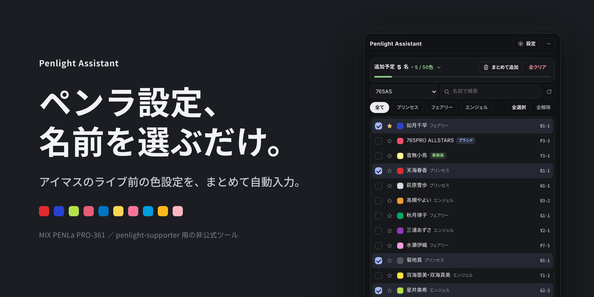

# Penlight Assistant (for MIX PENLa PRO-361)

ダウンロードありがとうございます！
本拡張機能は、MIX PENLa PRO-361（361色モード／56色モード）のWeb設定ツールでの設定作業を補助・高速化する目的で動作します。

**【🚨 重要】**
本ツールは「penlight-supporter」の**非公式**拡張機能です。
本拡張機能に関するお問い合わせや不具合報告等は、大元の「penlight-supporter」運営者様ではなく、**開発者（kqkk1）**までお願いいたします。

## 📥 導入方法
[Releases](https://github.com/kqkk1/penlight-assistant/releases/latest) から最新版のZIPをダウンロードして解凍し、Chrome等のブラウザの「拡張機能の管理画面」で「パッケージ化されていない拡張機能を読み込む」から、解凍したフォルダを選んでご利用ください。

## 📊 自分専用のリストを作りたい方へ
以下のURLから、テンプレート用のスプレッドシートをコピー（マイページに保存）してご利用ください。
🔗 [スプレッドシートテンプレート](https://docs.google.com/spreadsheets/d/1qQ1ezrI5ujr4YIi4hO3EmPSLRTULKtSSV_LQ1Q6SNGo/copy)
（※詳しい設定方法や使い方は、公開しているnoteの記事をご覧ください。）
（同じ色の2人を1つのボタンにまとめたいときは、A列を「双海亜美・双海真美」のように、それぞれの名前を「・」でつないで書くと、自動抽出でどちらの名前でも照合されます。J列「別名」（任意）にカンマ区切りで書いた名前でも照合できます）

## ⚠️ 免責事項・ご利用にあたってのお願い（必ずお読みください）
大元のWeb設定ツール「penlight-supporter」様へご迷惑をおかけしないため、以下の点をご理解・ご承諾のうえでご利用ください。

- **非公式ツールとしての自己責任でのご利用**
  本プログラムは有志が作成した非公式ツールです。本拡張機能に関するご意見、ご要望、エラーなどを「penlight-supporter」運営者様へ送ることは絶対におやめください。
- **元サイトの仕様変更・提供終了について**
  「penlight-supporter」の画面（UI）の変更や、サービスの提供終了は予告なく行われる場合があります。それに伴い本拡張機能が突然使用できなくなった場合でも、元サイト様側で互換性を保つなどの対応は一切行われません（本拡張機能側でも対応できない場合があります）。
- **公開停止の可能性について**
  万が一、本拡張機能の挙動が原因で「penlight-supporter」の正常な運営に支障が生じるような事態となった場合は、運営者様とのご相談・要請に基づき、予告なく本拡張機能の修正や公開の停止（配布終了）を行うことがあります。

## 🛠 仕様・プライバシーに関する注意事項
- 拡張機能は対象の設定サイト上（penlight-supporter.onrender.com）でのみ動作します。
- アイドル情報やカラー情報の取得のために、標準のスプレッドシートの内容を書き出したファイル（本リポジトリの data/colors.json。jsDelivr経由）を読み込みます。カスタムのスプレッドシートIDを設定した場合は、そのGoogleスプレッドシートを直接読み込みます。
- ピン留めの状態や、取得したデータのキャッシュなど、一部の設定情報はブラウザのlocalStorageに安全に保存されます。
- 外部の第三者サービスへユーザーの行動データを送信するような機能は一切ありません。
- ソースコードは本GitHubリポジトリからすべて確認できます。